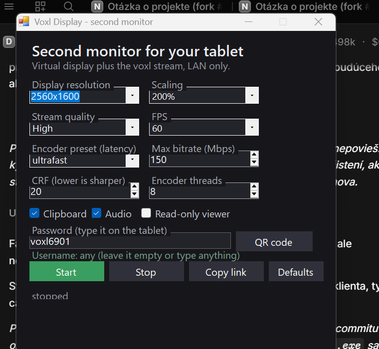

# Voxl Display

A control panel for using a tablet as a second monitor on Windows 10 and 11.

It does three things:

1. creates a **virtual monitor** through the signed [Virtual Display Driver](https://github.com/VirtualDrivers/Virtual-Display-Driver),
2. runs [voxl](https://github.com/tembo/voxl) to stream that monitor to a browser over HTTPS,
3. lets you pick the resolution, scaling, framerate and encoder settings from one window.

The tablet opens a link, scans a QR code if you like, and becomes a real extended
desktop: you can drag windows onto it, type into them and use the clipboard. Audio,
files and the on-screen keyboard are reachable from the page's toolbar.

Everything stays on the local network. Nothing is exposed to the internet.



## Requirements

- Windows 10 1809 or newer, or Windows 11, **x64**. ARM64 is not supported yet: the
  driver ships an ARM64 package, but there is no ARM64 build of voxl.
- Administrator rights once, for the install (driver and firewall rule).
- Both devices on the same network. Internet is only needed if you omit the bundled
  driver packages (they are included, so a normal install works offline).

The app itself is a single .NET Framework 4.x WinForms executable, compiled with the
C# compiler that ships with Windows. There is nothing else to install.

## Install

1. Download `VoxlDisplay-<version>.zip` from [Releases](../../releases) and unpack it.
2. Run **`install.cmd`** and accept the UAC prompt.

The installer:

- copies the app to `%LOCALAPPDATA%\VoxlDisplay`,
- installs the virtual display driver if the `MTT1337` monitor is missing,
- adds a firewall rule for TCP 6901, restricted to the local subnet,
- creates shortcuts on the desktop and in the Start menu.

It is safe to run twice: the driver is only installed when the monitor is absent.

## First run

Open **Voxl Display** from the desktop shortcut.

| Setting | What it does |
|---|---|
| Display resolution | the virtual monitor's mode. Offered values come from the driver; a custom value is accepted only if the driver advertises it. |
| Scaling | the monitor's DPI scale (125 % to 225 %). Steps depend on the resolution. |
| Stream quality | Low / Balanced / High / Maximum presets; Custom lets you set the numbers yourself. |
| FPS | 30, 50, 60, 90 or 120. The panel refresh of the virtual monitor caps this. |
| Encoder preset | `ultrafast` is the lowest latency, `faster` compresses better at the same quality. |
| Max bitrate | the ceiling for the encoder, in Mbps. A still desktop uses a fraction of it. |
| CRF | lower is sharper and larger. 18 to 22 is a good range for a desktop. |
| Encoder threads | x264 slice threads. More threads encode faster, slightly bigger files. |
| Clipboard / Audio | share the clipboard and the system audio with the tablet. |
| Read-only viewer | the tablet can watch but not type or click. |

Press **Start**. The status line shows the address, and **QR code** opens a scannable
code for the tablet.

On the tablet:

1. open `https://<pc-ip>:6901`, or scan the QR code,
2. accept the self-signed certificate once (the exception survives restarts),
3. sign in. The user name can be **anything**, only the password matters. The default
   password is `voxl6901`; change it in the app.
4. use the toolbar's fullscreen button, and "Add to home screen" to install it as a web app.

## Security

- voxl listens on the PC's LAN address only, never on `0.0.0.0`.
- The firewall rule allows TCP 6901 from the local subnet only. There is no port
  forwarding, so the internet cannot reach it.
- HTTPS uses a self-signed certificate that voxl creates once and keeps.
- Anyone who has the password gets full control of the desktop: keyboard, mouse,
  clipboard, screenshots and recording. Treat the password like a screen-sharing PIN.
- The app stores the password in plain text in `settings.json` next to the executable.
  That file is per user and never leaves the machine.
- To narrow the exposure further, set **Read-only viewer**, and restrict the firewall
  rule to the tablet's address:

```powershell
Get-NetFirewallRule -DisplayName "voxl 6901 (LAN)" | Get-NetFirewallAddressFilter |
    Set-NetFirewallAddressFilter -RemoteAddress 192.168.0.50
```

## Signing

Releases are signed with a self-signed certificate (`signing/voxl-display.cer`), not a
commercial one. Windows therefore shows **"Unknown publisher"** until the certificate is
trusted on that machine. To trust it, run elevated once:

```powershell
.\trust.ps1
```

After that the files show `CN=Judzim` as the publisher. SmartScreen may still warn on a
machine that has never seen the file; that reputation needs a paid certificate.

## Uninstall

```powershell
# elevated
.\uninstall.ps1                  # app, shortcuts, firewall rules, logon task, driver
.\uninstall.ps1 -KeepDriver      # the same, but leave the virtual display installed
```

That covers everything this project adds: the app folder, both shortcuts, every voxl
firewall rule, the logon task if one was created, the TLS certificate and the virtual
display driver.

## Build from source

```cmd
build.cmd
```

That runs the .NET Framework compiler on `VoxlDisplay.cs` and `Qr.cs`. The only
dependency is what Windows already has (`System.Windows.Forms`, `System.Drawing`).

The app has no dependency on voxl's source: it composes a command line and starts
`voxl.exe` from its own folder. To rebuild voxl for Windows, see the
[Windows build workflow](https://github.com/tembo/voxl) used by this project's fork.

## How it fits together

```
VoxlDisplay.exe  ── sets the monitor mode and DPI, starts voxl.exe
      │
voxl.exe         ── DXGI desktop duplication of the virtual monitor
      │             H.264 (x264) → WebSocket over TLS
      â–¼
tablet browser   ── WebCodecs decode, draws the desktop, sends input back
```

The virtual monitor is a normal device node (`ROOT\DISPLAY\0000`, hardware id
`Root\MttVDD`). Windows remembers its resolution, position and scale, so the setup
survives a reboot as long as the driver stays installed.

## Third-party components

| Component | License | Notes |
|---|---|---|
| [voxl](https://github.com/tembo/voxl) | MIT | unmodified upstream build, streamed as is |
| [Virtual Display Driver](https://github.com/VirtualDrivers/Virtual-Display-Driver) | MIT | signed by SignPath Foundation; the package is redistributed unmodified in `vendor/` |
| [nefcon](https://github.com/nefarius/nefcon) | MIT | creates the device node during install |

## Limitations

- One virtual monitor, index 2 in voxl's list (primary, then the physical displays, then
  the virtual one). The app works the index out from the current layout.
- A custom resolution must be advertised by the driver. To add one, edit
  `C:\VirtualDisplayDriver\vdd_settings.xml` and restart the display.
- The stream pauses while the PC is locked: Windows does not allow desktop duplication
  on the secure desktop. Unlock and start again.
- No auto-update. Replace the folder and run `install.cmd` again.

## Contributing

See [CONTRIBUTING.md](CONTRIBUTING.md).
